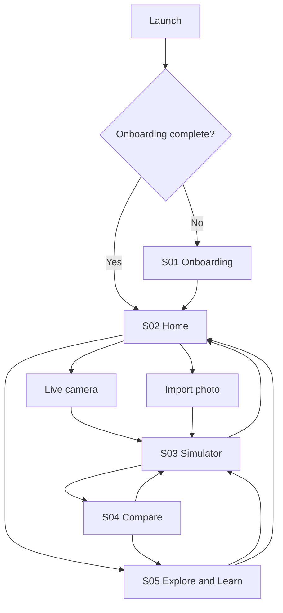
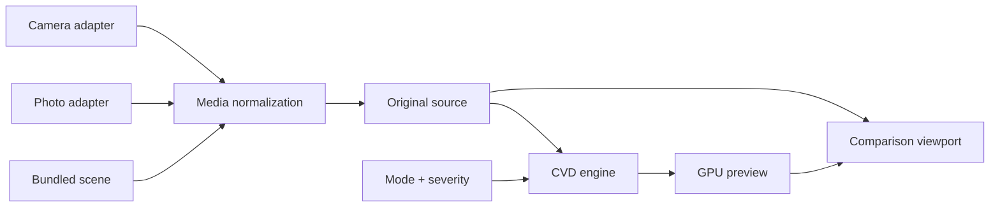

# My Eyes — See Through My Eyes

**Product Specification and Implementation Plan**

Version: 1.0 Draft
Status: Implemented and tested; see Section 17 and docs/verification.md for current status
Product: My Eyes – Nhìn qua đôi mắt của tôi
Tagline: One world. Many ways to see.
Audience: Product owners, designers, engineers, QA, and coding agents

## 1. Executive summary

My Eyes is an educational color vision deficiency (CVD) simulator. It helps people with typical color vision explore how certain color distinctions may become difficult for people with different forms of color vision deficiency. Users can simulate a live camera feed, import a photo, or select an educational scene, then compare the original and transformed image and learn about accessible design.

The product is not a diagnostic tool, a vision test, or a claim to reproduce any individual's subjective experience. Its purpose is education and empathy, not medical assessment.

Proposed MVP: a mobile-first, offline-first, privacy-first application with five screens, eight core features, five simulation mode groups, and no mandatory backend or account.

## 2. Product objectives and success metrics

| Objective | Proposed measurable target |
| --- | --- |
| Immediate access | First meaningful simulation within 30 seconds in a usability test |
| Learn through comparison | At least 80% of pilot participants can explain one color-related accessibility barrier after a session |
| Responsiveness | Target 30 FPS live preview and mode-switch latency under 100 ms on agreed reference devices |
| Offline operation | All P0 features work without network access after installation |
| Privacy | No camera frames or imported photos transmitted by the application |
| Accuracy | Pass reference color-transform fixtures and documented numerical tolerances |

Targets are provisional, not measured results. Define reference devices, pilot sample, measurement protocol, and tolerances before release.
Target users
- Students and educators exploring color perception.
- General audiences seeking to understand color-related accessibility barriers.
- Designers and developers assessing color-dependent interfaces.
- People with CVD who wish to explain their experience to others (without implying the simulation represents them exactly).

## 3. Scope and priorities

| ID | Feature | Priority | Screen |
| --- | --- | --- | --- |
| F-01 | Onboarding and guidance | P0 | S01 |
| F-02 | Live camera simulation | P0 | S03 |
| F-03 | Local photo import | P0 | S02, S03 |
| F-04 | Vision mode switching | P0 | S03, S04 |
| F-05 | Original/simulated comparison | P0 | S04 |
| F-06 | Simulation severity | P0 | S03, S04 |
| F-07 | Educational scene library | P0 | S05 |
| F-08 | Color vision education | P0 | S05 |
| F-09 | Export comparison images | P1 | S04 |
| F-10 | Educational color challenges (not diagnostic) | P1 | Future |
| F-11 | Accessible palette analysis | P2 | Future |
| F-12 | Imported video simulation | P2 | Future |

P0 is required for MVP release. P1 and P2 are explicitly excluded from the first implementation. No accounts, cloud sync, analytics SDK, AI inference, medical testing, payment, or custom scene CRUD are required.

## 4. User journey and information architecture



| Screen | Purpose | Core interactions | Required states |
| --- | --- | --- | --- |
| S01 Onboarding | Explain purpose and limits | Start, skip, reopen guidance | First visit, completed |
| S02 Home | Choose simulation source | Camera, photo, explore | Ready, picker canceled, import error |
| S03 Simulator | Explore a source | Select mode, adjust severity, freeze camera, compare | Loading, active, permission denied, unsupported camera, processing error |
| S04 Compare | Inspect original and simulated image | Split slider, side-by-side, mode/severity controls, reset | Ready, rendering error |
| S05 Explore & Learn | Learn through real-life scenes | Open scene, read explanations, accessibility tips | Ready, missing asset fallback |

Camera comparison freezes a single frame, so original and transformed images refer to the same moment. Returning to the live simulator resumes capture when permission and lifecycle permit. Back navigation preserves current session settings where practical; returning home releases camera resources.

## 5. Functional specifications and acceptance criteria

Each acceptance criterion uses a stable identifier. Implement, review, and test against the approved version of this plan.

### F-01 — Onboarding and guidance

User story: As a first-time user, I want to understand the app's educational purpose and start without creating an account.

Requirements: Introduce the product, demonstrate a comparison, state simulation limitations, allow skip/start, and store only the completion flag. Provide a way to reopen guidance from Home or Learn.

| Criterion | Expected behavior |
| --- | --- |
| F-01-AC-01 | First launch presents onboarding; Start or Skip opens Home without login. |
| F-01-AC-02 | Subsequent launches open Home after completion; guidance can be reopened. |
| F-01-AC-03 | Educational and non-diagnostic disclaimer is available before the first simulation. |

Implementation: Build onboarding screens within S01, local preference adapter, route guard, localized copy. Tests: T01–T03.

### F-02 — Live camera simulation

User story: As a user, I want to observe everyday objects through a simulated color vision mode in real time.

Requirements: Request camera permission only after the camera action. Use the rear camera by default; display an aspect-correct preview and apply only the image transform. Freeze one frame for comparison. Release resources when leaving or backgrounding; resume safely. No microphone permission is required.

| Criterion | Expected behavior |
| --- | --- |
| F-02-AC-01 | Granted permission opens an active, transformed camera preview. |
| F-02-AC-02 | Denied/restricted permission shows an explanation and actions to use an image or sample; offer Settings when appropriate. |
| F-02-AC-03 | Leaving or backgrounding releases or suspends capture; returning safely restores it when permitted. |
| F-02-AC-04 | Freeze creates one correctly oriented frame for original/simulated comparison. |
| F-02-AC-05 | Unavailable camera or initialization failure produces a recoverable error and a photo/sample alternative. |

Implementation: Camera adapter, permission state machine, preview renderer, lifecycle observer, freeze-frame pipeline. Validate the GPU integration in a technical spike before committing to live rendering architecture. Tests: T04–T08.

### F-03 — Local photo import

User story: As a user, I want to simulate a photo from my device privately.

Requirements: Use a system photo picker. Support JPEG and PNG in MVP; decode and normalize orientation and color profile where supported. Use a bounded preview size (proposed longest edge 2048 px), retain the original source unmodified, and dispose temporary data when the session ends. Handle cancellation, corrupt files, and unsupported formats.

| Criterion | Expected behavior |
| --- | --- |
| F-03-AC-01 | Valid JPEG/PNG opens in Simulator with correct aspect ratio and orientation. |
| F-03-AC-02 | Canceling the picker returns without a false error. |
| F-03-AC-03 | Corrupt/unsupported data shows a recoverable message without crashing. |
| F-03-AC-04 | Large images use bounded preview memory and the source file remains unchanged. |

Implementation: Picker adapter, image decoder, EXIF orientation handling, bounded resize, cleanup. Tests: T09–T12.

### F-04 — Vision mode switching

User story: As a user, I want to compare different color vision deficiency groups using the same source.

| Mode ID | Display name | Model behavior |
| --- | --- | --- |
| normal | Typical color vision | Identity transform |
| protan | Protan — red/green group | Machado protan matrices |
| deutan | Deutan — red/green group | Machado deutan matrices |
| tritan | Tritan — blue/yellow group | Machado tritan matrices |
| grayscale | Grayscale approximation | Linear RGB luminance conversion |

Protan, deutan and tritan cover a range of modeled deficiencies, including anomalous trichromacy and dichromacy endpoints. Grayscale is an approximation of absent color perception only; it does not model light sensitivity, acuity, or other effects of achromatopsia. Avoid describing any simulation as a universal person's experience.

| Criterion | Expected behavior |
| --- | --- |
| F-04-AC-01 | All five modes can be selected with visible text labels. |
| F-04-AC-02 | Each change transforms the original source, not a previously transformed output. |
| F-04-AC-03 | Typical vision returns the original display-normalized image. |
| F-04-AC-04 | Mode behavior matches reference fixtures within the approved tolerance. |

Implementation: Mode registry, reference matrix assets, CPU reference renderer, GPU renderer, accessible selector. Tests: T13–T16.

### F-05 — Original/simulated comparison

User story: As a user, I want to see the difference between original and simulated images clearly.

Requirements: Provide a draggable split comparison and side-by-side view. Both views use the same image, crop, orientation, and transform settings. Label both sides. Support keyboard and assistive-technology adjustment of the slider.

| Criterion | Expected behavior |
| --- | --- |
| F-05-AC-01 | Both views show the same source with consistent geometry. |
| F-05-AC-02 | Split position 0% shows simulation only; 100% shows original only; 50% splits the image equally. |
| F-05-AC-03 | Side-by-side and split modes preserve selected vision mode and severity. |
| F-05-AC-04 | Slider is operable without relying on visual color or drag gestures alone. |

Implementation: Shared image viewport, clip rendering, compare slider semantics, layout switch. Tests: T17–T20.

### F-06 — Simulation severity

User story: As a user, I want to explore different modeled strengths of a color vision deficiency.

Requirements: Display 0–100% model strength, proposed step 5%. For protan/deutan/tritan, use the Machado matrices at the published levels and interpolate between adjacent levels as documented by the model author. Disable the control for typical vision and grayscale in MVP. A percentage is a model parameter, not a clinical severity score. Preserve the previous CVD strength when switching between eligible modes.

| Criterion | Expected behavior |
| --- | --- |
| F-06-AC-01 | 0% produces the identity transform; 100% selects the maximum model matrix. |
| F-06-AC-02 | Intermediate values select/interpolate adjacent published matrices correctly. |
| F-06-AC-03 | Typical and grayscale modes have a disabled or hidden severity control with explanation. |
| F-06-AC-04 | Input is clamped to the supported range; switching eligible modes preserves strength. |

Implementation: Matrix lookup/interpolation, slider state, accessible value announcement, unit tests. Tests: T21–T24.

### F-07 — Educational scene library

User story: As a user, I want to explore practical situations without camera permissions or my own photos.

Requirements: Bundle six licensed or original sample images and localized descriptions. Each scene opens in Simulator and links to relevant educational content. No network dependency.

| Scene | Example barrier | Accessibility tip |
| --- | --- | --- |
| Traffic signals | Identifying signal color | Use position, shape and contextual cues; never rely on a simulation for real driving decisions |
| Food | Red/green ripeness cues | Use labels, texture and other appropriate cues |
| Clothing | Distinguishing hues | Add explicit color names |
| Nature | Flowers against foliage | Use shapes and contrast |
| Charts | Red/green series | Direct labels, patterns and line styles |
| Education | Colored classroom materials | Pair color with symbols or text |

| Criterion | Expected behavior |
| --- | --- |
| F-07-AC-01 | All six scenes open offline without permissions. |
| F-07-AC-02 | Each scene has an explanation and accessibility tip. |
| F-07-AC-03 | Missing asset shows a safe fallback and allows navigation. |

Implementation: Bundled scene manifest, asset licensing register, scene cards, detail content. Tests: T25–T27.

### F-08 — Color vision education

User story: As a user, I want to understand what the simulation represents and its limitations.

Requirements: Include plain-language information for each mode, model limitations, sources, and accessible design suggestions. Use respectful wording and avoid implying that all people with CVD have identical experiences. Provide links as optional external resources; core content is bundled.

| Criterion | Expected behavior |
| --- | --- |
| F-08-AC-01 | Every mode has an offline explanation and limitation statement. |
| F-08-AC-02 | Educational content includes source attribution and non-diagnostic guidance. |
| F-08-AC-03 | English and Vietnamese content is complete, consistent, and readable with assistive technology. |

Implementation: Localized educational content, mode detail cards, source references. Tests: T28–T30.

## 6. UX and accessibility design

Visual direction
Clean, image-first, empathetic, modern. The application chrome remains unfiltered. Simulations apply exclusively to media viewports.

| Token | Proposed value |
| --- | --- |
| Primary | #2563EB |
| Text / ink | #0F172A |
| Light surface | #F8FAFC |
| Muted text | #64748B (verify contrast on each surface) |
| Accent | #D97706 (not a sole status indicator) |
| Typography | Inter / Be Vietnam Pro, with system fallback |
| Body | 16 logical px minimum default |
| Heading | 24–32 logical px |
| Spacing | 4, 8, 16, 24, 32 |
| Corner radius | 12–20 logical px |
| Touch target | 48 × 48 logical px preferred minimum |

Support light/dark themes, text scaling, portrait and adaptive landscape layouts, visible focus, accessible names and values, and alternatives to gesture-only actions. Target WCAG 2.2 AA principles where applicable to native mobile UI: 4.5:1 normal text contrast, 3:1 large text and essential non-text controls, and no color-only indicators. Validate rather than assuming palette compliance.
Core components
- SourceActionCard: icon, title, description, focus/pressed state.
- VisionModeSelector: text labels, selected indicator, screen-reader state.
- SimulationViewport: aspect-correct media, loading and error states.
- SeverityControl: numeric model strength, disabled explanation, accessible adjustment.
- CompareViewport: labeled original and simulated views, adjustable split.
- SceneCard: image, title, accessibility description.
- EducationalNotice: concise disclaimer and links to detailed explanation.
State messages

| Condition | Suggested English copy |
| --- | --- |
| Permission denied | Camera access is unavailable. You can still choose a photo or explore a sample. |
| Import failed | This image could not be opened. Choose a supported JPEG or PNG file. |
| Processing | Preparing your simulation… |
| Camera unavailable | The camera is unavailable. Try a photo or sample instead. |
| Disclaimer | This is an educational approximation of color vision, not a medical test or an exact recreation of anyone's vision. |

## 7. Technical architecture

Proposed stack (requires approval)

| Layer | Choice |
| --- | --- |
| Platform | Android and iOS; mobile-first |
| Framework | Flutter / Dart |
| Camera | Flutter camera integration, subject to GPU pipeline spike |
| Photo picker | System photo picker via compatible Flutter plugin |
| Rendering | Flutter fragment shader or native GPU adapter if needed |
| Preferences | SharedPreferences or equivalent local preference store |
| Localization | Flutter localization with English and Vietnamese ARB assets |
| Backend / database | None for MVP |
| Tests | Dart unit/widget tests, Flutter integration tests, real-device validation |

Do not pin unverified plugin versions in this plan. At implementation kickoff, check official compatibility, platform minimums, licensing, and maintenance; lock resolved dependencies. If the Flutter camera texture cannot be transformed efficiently by a fragment shader, evaluate native frame processing/texture integration. Do not replace real-time simulation with a cosmetic filter or falsely claim live support.

Separate UI state, source adapters, pure color transformation logic, rendering implementation, and bundled educational content. A CPU reference implementation must be independent of the GPU shader so that fixtures can detect shader errors. Keep the original source immutable during each simulation session.

## 8. Color simulation engine specification

Pipeline
1. Decode image or camera data; honor orientation and source color metadata where available.
2. Convert camera YUV or other source formats to display-normalized sRGB with the correct range and color conversion metadata. Handle wide-gamut inputs by conversion to sRGB where possible.
3. Normalize encoded sRGB channels to [0,1]. Convert each to linear RGB: c / 12.92 if c <= 0.04045; otherwise ((c + 0.055) / 1.055)^2.4.
4. Select the transform. Typical vision uses identity. Protan/deutan/tritan use the selected published Machado matrix level; intermediate levels interpolate adjacent matrices. Grayscale uses linear luminance Y = 0.2126 R + 0.7152 G + 0.0722 B and outputs (Y,Y,Y).
5. Multiply the 3×3 matrix by the linear RGB column vector in the documented row order. Clamp resulting channels to [0,1].
6. Encode linear channel v to sRGB: 12.92*v if v <= 0.0031308; otherwise 1.055*v^(1/2.4)-0.055.
7. Preserve alpha, with correct handling of premultiplied alpha; render the output and original using consistent display color management.
Never apply the transformation cumulatively to previous outputs. Avoid a second color-space conversion when the GPU texture is already linear. Confirm shader precision and matrix orientation on both platforms.
Engine contract
simulate(source, mode, strength) -> simulated frame
mode: normal | protan | deutan | tritan | grayscale
strength: finite numeric value in [0,1]
input: normalized source frame or texture with known color encoding
output: same dimensions, orientation and alpha semantics
errors: invalid source, unsupported encoding, renderer failure
The core engine accepts only normalized valid input; adapters provide validation and error mapping. Typical mode should use a pass-through path where possible. Grayscale is fixed-strength in MVP. Reference matrices must be imported from the published model table, reviewed for transcription accuracy, versioned, and accompanied by source attribution and applicable usage terms.
Validation requirements
- Golden fixtures: black, white, neutral grays, saturated primaries, secondary colors, gradients, and representative photographic patches.
- Test every model family at 0, 0.1, 0.5, 0.55, and 1.0, plus invalid inputs.
- Proposed tolerance: CPU reference vs independently calculated fixtures within 1 encoded 8-bit channel level; GPU vs CPU within 2 levels for controlled sRGB fixtures. Confirm or revise after the technical spike; document any platform-specific deviation.
- Validate YUV conversion, orientation, alpha and color-profile normalization separately from the matrix transform.
- Test with real devices; visual plausibility alone is not sufficient. Invite feedback from people with CVD without treating subjective feedback as numerical validation.

## 9. Data model and privacy

VisionMode { id, labelKey, descriptionKey, modelType, supportsSeverity }
SimulationState { sourceType, sourceHandle, modeId, strength, comparePosition, compareLayout, frozen }
SampleScene { id, titleKey, assetPath, altTextKey, category, explanationKey, tipKey, licenseRef }
AppSettings { locale, theme, onboardingCompleted }
sourceHandle is an ephemeral in-memory or temporary-file reference, not a database record. strength and comparePosition are normalized to [0,1]. Default mode: deutan; default strength: 1; split: 0.5. Default locale follows supported system locale, otherwise English. Default theme follows system setting. These are proposed defaults.

Only application settings persist. Bundle content in read-only manifests and localization files. No user account, image upload, cloud sync, or image history in MVP. Delete app-created temporary media when no longer needed and attempt cleanup of abandoned temporary files on startup; do not modify or delete user originals. Disable unintended third-party telemetry and inspect network behavior. Request least privilege; avoid broad media access when system picker suffices. Publish a clear privacy notice and platform permission descriptions.

## 10. Proposed repository layout

```text
my-eyes/
  README.md
  pubspec.yaml
  lib/
    main.dart
    app/                 # routing, theme, localization
    features/
      onboarding/
      home/
      simulator/
      comparison/
      explore/
    core/
      color_vision/      # matrices, reference transform, renderer contract
      media/             # camera, picker, decoder, source lifecycle
      preferences/
    l10n/
  assets/
    shaders/
    matrices/
    scenes/
    licenses/
  test/
    unit/
    widget/
    fixtures/
  integration_test/
  docs/
    PLAN.md
    features/            # F-01 through F-08 specifications
    architecture.md
    design.md
    test-plan.md
    traceability.md
    references.md
    release-checklist.md
```

This is a planned structure, not a generated or existing code repository. Adapt it to Flutter conventions and avoid empty placeholder modules.

## 11. Implementation roadmap

Five-week illustrative schedule for a small team; estimates are not commitments. Dependencies and device support must be confirmed first.

| Phase | Work items | Exit criteria | Target |
| --- | --- | --- | --- |
| 0 — Specification | Approve scope, model, platforms, privacy, content and acceptance criteria | Spec approved; open decisions resolved | Week 1 |
| 1 — Technical spike | CPU reference, shader fixture comparison, camera texture path, device benchmark | Feasible rendering path and documented tolerances | Week 1 |
| 2 — Foundation | Flutter project, navigation, themes, localization, onboarding, Home | F-01 passes; app builds on target platforms | Week 2 |
| 3 — Static simulator | Import, mode registry, severity, CPU/GPU renderer | F-03/F-04/F-06 pass | Week 3 |
| 4 — Live camera and comparison | Camera lifecycle, freeze, comparison layouts and controls | F-02/F-05 pass on devices | Week 3–4 |
| 5 — Education | Six scene assets, educational copy, translations and sources | F-07/F-08 pass offline | Week 4 |
| 6 — Hardening and release | Regression, accessibility, privacy, performance, packaging | Release gates met and evidence documented | Week 5 |

Feature execution workflow
For each F-ID: Spec → Plan → Code → Review → Test.
1. Freeze the applicable acceptance criteria; identify affected modules and dependencies.
2. Write a short implementation plan and map each criterion to tests.
3. Implement the complete user-facing behavior with explicit loading/error states.
4. Review the diff against criteria, resource lifecycle, accessibility, privacy, and edge cases.
5. Run mapped tests and regression checks; record command, environment, result, and evidence path.
6. Mark complete only when criteria are met and verification evidence exists. Update spec, code, and tests together when behavior changes.
Suggested order: F-01 → F-04 → F-06 → F-03 → F-02 → F-05 → F-07 → F-08. F-04/F-06 depend on the engine spike; F-02 depends on a viable camera/rendering path; F-05 depends on immutable source and renderer contracts; F-07/F-08 can be prepared in parallel.

## 12. Test plan and traceability

| Test ID | Acceptance criterion | Scenario / expected result | Type |
| --- | --- | --- | --- |
| T01 | F-01-AC-01 | First launch, Start and Skip lead to Home without login | Widget/integration |
| T02 | F-01-AC-02 | Relaunch skips completed onboarding; guidance reopens | Integration |
| T03 | F-01-AC-03 | Disclaimer is present before simulation | Widget/manual |
| T04 | F-02-AC-01 | Grant permission, camera opens with transformed preview | Device |
| T05 | F-02-AC-02 | Deny/restrict permission, alternatives work | Device |
| T06 | F-02-AC-03 | Background/resume and route exit do not leak camera | Device |
| T07 | F-02-AC-04 | Freeze same frame, correct orientation | Device |
| T08 | F-02-AC-05 | Initialization failure recovers to alternate source | Integration |
| T09 | F-03-AC-01 | JPEG/PNG, EXIF rotation and aspect ratio | Unit/integration |
| T10 | F-03-AC-02 | Cancel picker without error | Integration |
| T11 | F-03-AC-03 | Corrupt and unsupported files fail safely | Unit/integration |
| T12 | F-03-AC-04 | Large image bounded preview, original unchanged | Device |
| T13 | F-04-AC-01 | Select every labeled mode | Widget |
| T14 | F-04-AC-02 | Repeated mode changes never compound transforms | Unit/widget |
| T15 | F-04-AC-03 | Typical vision produces identity output | Unit/golden |
| T16 | F-04-AC-04 | Reference fixtures match CPU and GPU outputs | Unit/device |
| T17 | F-05-AC-01 | Matching crop, dimensions and source in both views | Golden/device |
| T18 | F-05-AC-02 | Split at 0, 50, 100 percent | Widget/golden |
| T19 | F-05-AC-03 | Layout switch retains simulation settings | Widget |
| T20 | F-05-AC-04 | Accessible slider adjustment without dragging | Manual/device |
| T21 | F-06-AC-01 | Strength 0 and 1 match identity and endpoint | Unit |
| T22 | F-06-AC-02 | Published levels and interpolated 0.55 fixture | Unit |
| T23 | F-06-AC-03 | Normal and grayscale disable strength | Widget |
| T24 | F-06-AC-04 | Boundary values, invalid input, mode switching | Unit/widget |
| T25 | F-07-AC-01 | All six scenes work in airplane mode | Integration |
| T26 | F-07-AC-02 | Each scene has explanation and tip | Unit/widget |
| T27 | F-07-AC-03 | Missing asset fallback | Widget |
| T28 | F-08-AC-01 | All mode explanations available offline | Integration |
| T29 | F-08-AC-02 | References and limitations reviewed | Manual |
| T30 | F-08-AC-03 | EN/VI completeness and screen reader navigation | Manual/widget |
| T31 | Cross-cutting | Frame rate, mode latency, image processing benchmark | Device |
| T32 | Cross-cutting | No media upload; permissions and temp cleanup | Device/manual |
| T33 | Cross-cutting | Light/dark contrast, text scaling, focus, labels | Manual/widget |
| T34 | Cross-cutting | Small/large screen, rotation, interruption recovery | Device |
| T35 | Cross-cutting | Educational usability pilot and comprehension | User study |

Test execution protocol
Use flutter analyze, flutter test, and flutter test integration_test after dependencies and device configuration are established. Build Android and iOS artifacts with documented Flutter commands for the selected environment. Record device model, OS, app revision, fixture version, actual FPS/latency, pass/fail, and logs. Device tests must include physical cameras; simulator-only testing is insufficient. Test performance in release/profile mode using a defined reference resolution and repeated measurements; report median and p95 latency as applicable.

No test has been executed as part of this planning deliverable.

## 13. Risks and mitigation

| Risk | Impact | Mitigation / decision gate |
| --- | --- | --- |
| GPU camera texture incompatibility | High | Early spike; use native adapter if required; negotiate scope if live rendering is infeasible |
| Incorrect gamma/matrix order/YUV conversion | High | Independent fixtures, documented pipeline and device validation |
| Model oversimplifies individual perception | High | Explicit limitations, educational review, no clinical claims |
| Memory pressure from large images | Medium | Bounded preview, resource disposal, stress tests |
| Camera interruption or permission denial | Medium | Lifecycle state machine, alternate sources |
| Inaccessible controls | High | Screen reader checks, non-color indicators, contrast testing |
| Unlicensed scene imagery | Medium | Use original or licensed assets; track attribution |
| Photo privacy leakage | High | Local processing, no telemetry, network and cleanup tests |
| Schedule uncertainty | Medium | Gate estimates on technical spike and agreed device matrix |

## 14. Release gates and definition of done

- [ ] Product owner approves scope, platforms, design direction, and non-diagnostic framing.
- [ ] All F-01–F-08 acceptance criteria implemented, reviewed, and tested with traceable evidence.
- [ ] Model matrices, source attribution, interpolation and color pipeline verified.
- [ ] Camera technical spike and reference device benchmarks documented.
- [ ] Six educational scenes available offline with rights and attribution documented.
- [ ] English and Vietnamese UI/content reviewed for accuracy and readability.
- [ ] Accessibility checks pass on supported platforms; known exceptions documented and approved.
- [ ] Privacy and permissions reviewed; no unexpected image transmission.
- [ ] Regression, build, static analysis, and physical-device tests pass.
- [ ] No unresolved critical/high-severity release blockers.
- [ ] README contains setup, run, test and known limitations; release notes and privacy notice prepared.

## 15. Open decisions and assumptions

| Decision | Proposed default | Approval required |
| --- | --- | --- |
| Platform | Android + iOS | Yes |
| Framework | Flutter/Dart | Yes |
| App languages | English + Vietnamese | Yes |
| P0 camera | Real-time, rear camera | Yes |
| Initial mode | Deutan at 100% | Yes |
| Grayscale | Fixed-strength approximation | Yes |
| Theme | System light/dark | Yes |
| Distribution | Local demo first; no public deployment | Yes |
| Minimum OS and reference devices | Determine during spike | Yes |
| Numerical and performance tolerances | Proposed in sections 2 and 8 | Yes |
| Asset source and educational reviewers | To be selected | Yes |

If a camera performance or integration blocker appears, do not silently remove F-02; document the trade-off and seek approval for any change to P0 scope. This English-language plan preserves Vietnamese as a proposed app language, not a requirement to translate this document.

## 16. Reference starting points

Validate sources and applicable licensing/usage terms at implementation kickoff. These references are starting points, not a completed literature or dependency audit.
- Machado, G. M., Oliveira, M. M., & Fernandes, L. A. F. (2009). A Physiologically-based Model for Simulation of Color Vision Deficiency. IEEE Transactions on Visualization and Computer Graphics, 15(6), 1291–1298. DOI: https://doi.org/10.1109/TVCG.2009.113
- Machado model and reference matrices: https://www.inf.ufrgs.br/~oliveira/pubs_files/CVD_Simulation/CVD_Simulation.html
- National Eye Institute, Color Blindness: https://www.nei.nih.gov/learn-about-eye-health/eye-conditions-and-diseases/color-blindness
- W3C WCAG 2.2: https://www.w3.org/TR/WCAG22/
- Flutter documentation: https://docs.flutter.dev/
- Flutter fragment shaders: https://docs.flutter.dev/ui/design/graphics/fragment-shaders

## 17. Handoff status

| Feature | Spec | Plan | Code | Review | Executed tests |
| --- | --- | --- | --- | --- | --- |
| F-01 | Done | Done | Done | Done | Pass |
| F-02 | Done | Done | Done | Done | Pass (device checks open, see verification.md) |
| F-03 | Done | Done | Done | Done | Pass |
| F-04 | Done | Done | Done | Done | Pass (GPU/CPU parity device check open) |
| F-05 | Done | Done | Done | Done | Pass |
| F-06 | Done | Done | Done | Done | Pass |
| F-07 | Done | Done | Done | Done | Pass |
| F-08 | Done | Done | Done | Done | Pass |

Next action: none blocking for the MVP code path. Remaining work is release packaging (signing, store listings) and the physical-device checks logged in docs/verification.md (camera permission flows, screen reader validation, on-device FPS). See docs/verification.md for the latest executed command results and dates.
